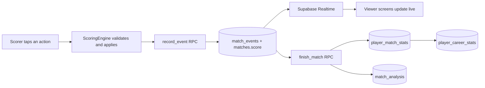

# VIT-AP Sports

A premium sports community app built exclusively for the students of **VIT-AP University**. Build your sports profile, form teams, schedule matches, score them live, and track stats and leaderboards across the campus.

---

## Table of Contents

1. [Vision](#vision)
2. [Features](#features)
3. [Design Philosophy](#design-philosophy)
4. [Tech Stack](#tech-stack)
5. [Architecture](#architecture)
6. [Live Match Scorer](#live-match-scorer)
7. [Scoring Rules](#scoring-rules)
8. [Player Stats and Match Analysis](#player-stats-and-match-analysis)
9. [Database Overview](#database-overview)
10. [Security](#security)
11. [Getting Started](#getting-started)
12. [Project Structure](#project-structure)
13. [Testing](#testing)
14. [Roadmap](#roadmap)

---

## Vision

VIT-AP Sports gives every student athlete a home on campus. Players create profiles, join or captain teams in different sports, challenge other teams, and follow live scorecards and leaderboards. The focus is on three sports first: **Cricket, Badminton and Football**.

## Features

### Authentication and Onboarding
- Single "Continue with Google" flow, restricted to the VIT-AP email domain
- Minimal auth screen: logo and one primary action

### Player Profiles
- Player card: name, branch, year, hostel block, photo, and multi-select sports with skill levels
- Career stats per sport (see [Player Stats](#player-stats-and-match-analysis)), form, recent matches
- Badge grid showing earned and unearned achievements

### Teams
- Create or join teams per sport; captains manage rosters and schedule matches
- Team hub with logo, roster, win/loss record, upcoming fixtures and match history
- "Looking for players" recruitment posts

### Matches and Challenges
- Match creation: sport, venue, date/time, format
- Team vs team challenges with accept/decline and push notifications
- Pick-up games with individual RSVP (no official team required)

### Live Scoring
- Ball-by-ball / point-by-point / event-by-event scorer for cricket, badminton and football
- Realtime viewer with animated score updates
- Undo, offline-tolerant event queue, and post-match summary cards

### Community
- Global and sport-specific leaderboards (top scorers, wicket takers, most active, best win rate)
- Activity feed: results, new teams, earned badges

### Upcoming
- Tournaments: automated knockout brackets and auto-updating league tables

## Design Philosophy

The app is built for Android with Material 3, but follows **Apple Human Interface Guidelines** principles:

- Minimalism, clarity, and deference to content
- Strict 8pt grid
- One sans-serif typeface used app-wide
- Strong contrast and purposeful animation
- A custom design-system widget layer (`AppButton`, `AppCard`, `AppTextField`, ...) so every screen stays consistent

New screens must reuse the design-system widgets and theme tokens. No ad-hoc colours, fonts or styles.

## Tech Stack

**Frontend**
- Flutter (latest stable), Material 3 (`useMaterial3: true`)
- State management: Riverpod (`flutter_riverpod`, `riverpod_annotation`)
- Routing: GoRouter
- UI: `google_fonts` (single family, e.g. Inter), custom design-system widgets
- Images: `image_picker`, `flutter_image_compress`, `cached_network_image`
- Utilities: `shimmer`, `intl`, `timeago`, `shared_preferences`

**Backend (Supabase, free tier)**
- PostgreSQL, with JSONB for flexible data (scorecards, event payloads, stat snapshots)
- Supabase Auth with Google OAuth, restricted to the VIT-AP email domain by a Postgres trigger
- Supabase Realtime for live scores and match status
- Row Level Security on every table

## Architecture



Key ideas:

- **Event sourcing.** Every scoring action is an immutable row in `match_events`. The current score is derived by folding events, so undo, corrections and stats are always consistent.
- **One source of rules.** Pure Dart, UI-free `ScoringEngine` per sport, registered in a sport registry. Adding a sport does not change the scorer screen shell.
- **Atomic writes.** RPCs insert the event and update the score snapshot in one transaction, and only allowed scorers can call them.
- **Counters, not ratios.** Stats store raw counters (runs, balls, wickets). Averages, strike rates and economy are derived at read time.

## Live Match Scorer

### Match lifecycle

`scheduled` → `live` → (`paused`) → `completed` or `abandoned`

### Event model

Each row in `match_events`:

| Column | Purpose |
|---|---|
| `id` | UUID generated on the client (makes retries idempotent) |
| `match_id` | Match the event belongs to |
| `seq` | Order within the match, unique per match |
| `type` | e.g. `ball`, `wicket`, `goal`, `rally_won`, `card` |
| `team_id`, `player_id` | Who the event is about |
| `payload` | Sport-specific details (JSONB) |
| `created_by`, `created_at` | Scorer and timestamp |

### Writing and viewing

1. The scorer taps an action. The engine validates it and updates local state immediately.
2. The `record_event` RPC checks permissions, inserts the event and updates `matches.score` in one transaction.
3. Realtime pushes the change to every subscribed viewer.
4. Viewers watch a Riverpod `StreamProvider`, and the timeline subscribes first, then loads initial data, so no events are missed.
5. On app resume, providers are refreshed to cover any missed updates.

### Scorer screen

- Large tap targets, haptic feedback, an always-visible **Undo**
- Confirmation only for destructive actions (finish match, abandon)
- Optimistic updates with an offline retry queue and a subtle "syncing" state
- One active scorer at a time, with a captain/creator "take over scoring" action

### Finishing a match

`finish_match` is atomic and idempotent. It sets the result, updates team records and player stats, generates the match analysis, and posts to the activity feed. Calling it twice does not double-count.

## Scoring Rules

### Football

- Defaults (configurable): 7 players per side, 2 halves of 20 minutes
- Goal kinds: open play, penalty, free kick, header, other
- **Own goal** counts for the opposing team and is credited to the player as an own goal
- Second yellow card automatically becomes a red card
- Substitutions are validated (player on the pitch out, unused bench player in)
- Penalty shootout: 5 kicks each, then sudden death. The shootout score is shown separately and never changes match goals
- League points: win 3, draw 1, loss 0. Tie-breakers: goal difference, then goals for
- Walkover default: 3-0 (configurable)

### Badminton

- Rally-point scoring: every rally awards one point
- Game: first to 21, win by 2, capped at 30 (at 29-29 the next point wins)
- Match: best of 3 games (casual single-game mode available)
- Serving: the side that wins a rally serves next. Even score serves from the right court, odd from the left. Doubles tracks each player's court position
- Intervals: prompt at 11 points (60s) and between games (120s). Change ends after each game, and in game 3 when the leading score reaches 11
- Retirement: opponent wins the match, scores so far are kept. Walkover is recorded as 2-0 (21-0, 21-0)

### Cricket

- Defaults (configurable): 6 overs, 11 players per side, max overs per bowler = ceil(overs / 5)
- Legal delivery counts toward the over. Six legal deliveries make an over
- **Wide:** not a legal ball. 1 penalty run plus any runs run. No ball faced by the batter
- **No-ball:** not a legal ball. 1 penalty run. Bat runs go to the batter. The next ball is a **free hit** (only run out is possible)
- **Bye / leg bye:** legal ball. Runs go to team extras, not the batter or the bowler
- **Strike rotation:** odd runs swap strike. Strike also swaps at the end of each over
- **Wickets:** bowled, caught, lbw, stumped, hit wicket, run out, obstructing the field, retired out. Retired hurt is not a wicket. Only bowled, caught, lbw, stumped and hit wicket are credited to the bowler
- **Maiden:** an over with no runs off the bat and no wides or no-balls
- **Innings ends:** overs complete, all out, or target reached
- **Result:** won by runs or by wickets. Equal totals lead to a super over or a tie. Abandoned means no result

## Player Stats and Match Analysis

### How stats flow

1. Engines fold events into per-player match stats. The striker, non-striker and bowler are tracked on every ball and stored on each event.
2. `finish_match` upserts one `player_match_stats` row per player per match.
3. Career totals are **recomputed** from match rows (not incremented), so reruns and corrections are safe.
4. Only completed matches count. Abandoned matches and walkovers do not. Guest players appear in a match's analysis but never create career stats.

`recompute_player_stats(player_id)` and `recompute_all_stats()` rebuild everything from match data and are used for backfills.

### Stats catalogue

**Cricket batting:** matches, innings, not outs, runs, balls faced, fours, sixes, dot balls, highest score, 25+/50+/100+ scores, ducks, golden ducks, dismissal types.
Derived: average, strike rate, boundary %, balls per boundary, dot-ball %, form.

**Cricket bowling:** innings bowled, legal balls, maidens, runs conceded, wickets, wides, no-balls, dot balls, boundaries conceded, best figures, 3- and 5-wicket hauls.
Derived: overs, economy, bowling average, bowling strike rate, dot-ball %.

**Cricket fielding and captaincy:** catches, stumpings, run outs, matches captained, captain wins.

**Football:** matches, starts, minutes, goals (by kind), assists, own goals, penalties scored/missed, shootout kicks, yellow and red cards, clean sheets, wins/draws/losses.
Derived: goals per match, goal contributions, minutes per goal, penalty conversion %, win %.

**Badminton (singles and doubles tracked separately):** matches, wins, losses, games won/lost, points won/lost, deciders, comeback wins, straight-game wins, close games, win streaks, partner records.
Derived: win %, point win %, average points per game.

**All sports:** sports played, total matches, overall win %, form (last 5), streaks, player-of-the-match count, head-to-head records.

Undefined ratios (for example, average with zero dismissals) are shown as `-`.

### Match analysis

Every completed match has a cached analysis (`match_analysis`) shown on the Match Analysis screen:

- **Cricket:** full scorecard, fall of wickets, over-by-over runs, worm chart, run rate and required rate, partnerships, run distribution, phase analysis, extras breakdown
- **Football:** score timeline, goals/cards/subs with minutes, goals by period, lineups with minutes, shootout summary
- **Badminton:** game scores, point progression, biggest lead, longest scoring run, deuce points, serve vs receive points

A suggested **Player of the Match** is computed from a documented points formula (the creator can override it).

## Database Overview

Core and scorer tables (names may differ slightly in your schema):

| Table | Purpose |
|---|---|
| `profiles` | Player details and sports |
| `teams`, `team_members` | Teams and rosters |
| `matches` | Fixtures, status, config, score snapshot, result, scorers |
| `match_participants` | Players per team per match (guests supported) |
| `match_events` | Immutable scoring events |
| `player_match_stats` | One row per player per match |
| `player_career_stats` | Aggregated career counters |
| `match_analysis` | Cached analysis per match |

All schema changes live in timestamped files under `supabase/migrations`. Migrations must be safe to re-run and non-destructive.

## Security

- Sign-ups are limited to the VIT-AP email domain by a Postgres trigger
- RLS is enabled on every table. Data is readable by authenticated users, and writes are limited to the right roles (captains, match creators, designated scorers)
- Scoring and stats writes go through `security definer` RPCs. Clients cannot write directly to event or stats tables
- Realtime respects RLS, so viewers only receive rows they are allowed to read

## Getting Started

### Prerequisites

- Flutter (latest stable) and an Android emulator or device
- A Supabase project (free tier is enough)
- Google OAuth credentials configured in Supabase Auth

### Setup

```bash
git clone <your-repo-url>
cd vit-ap-sports
flutter pub get
```

Provide your Supabase credentials using the method your project already uses (for example `--dart-define` or an environment file):

```bash
flutter run \
  --dart-define=SUPABASE_URL=<your-supabase-url> \
  --dart-define=SUPABASE_ANON_KEY=<your-anon-key>
```

Never commit service-role keys. Only the anon key belongs in the app.

### Supabase setup

1. Apply the migrations in `supabase/migrations` in order (SQL editor or Supabase CLI).
2. Enable Google as an auth provider and add the VIT-AP domain restriction trigger.
3. Enable Realtime on `matches` and `match_events`:

   ```sql
   alter publication supabase_realtime add table matches, match_events;
   alter table match_events replica identity full;
   ```

4. Confirm RLS is enabled on every table.

### Free-tier note

Supabase free tier limits concurrent Realtime connections and message throughput. Subscribe only on match screens and remove channels when leaving them (use `autoDispose`). Check Supabase's current limits for your plan.

## Project Structure

<!-- Update this section to match the actual repository layout -->

```
lib/
  core/            # theme, design system widgets, router, utils
  features/
    auth/
    profile/
    teams/
    matches/
    scorer/        # engines (cricket, badminton, football), scorer UI, viewer UI
    stats/         # stats models, profile stats, match analysis
    community/     # leaderboards, activity feed
supabase/
  migrations/      # timestamped, non-destructive SQL
docs/
  scorer/          # audit, status, scorer architecture
  stats/           # stats model, formulas, Supabase change notes
```

## Testing

```bash
flutter analyze
flutter test
```

- Scoring engines are pure Dart and tested with scenario tables (for example: badminton 29-29 ends at 30-29, a cricket wide does not advance the over, a football own goal credits the opponent)
- Folding all events must always reproduce the stored score snapshot, and undoing the last event must restore the exact previous state
- Stats tests cover idempotent `finish_match`, recompute from match rows, and guest players never creating career rows
- Database checks cover: non-scorers cannot write events, duplicate `seq` values are rejected, and direct writes to stats tables are denied

## Roadmap

- [x] Authentication with domain restriction
- [x] Profiles, teams, challenges, pick-up games
- [x] Leaderboards and activity feed
- [ ] Live scorer: football, badminton, cricket
- [ ] Automatic player stats and per-match analysis
- [ ] Tournaments: knockout brackets and league tables
- [ ] Shareable match cards
- [ ] Match reminders and availability polls
- [ ] Inter-hostel and inter-branch leagues

## Contributing

Open an issue or a pull request. Please run `flutter analyze` and `flutter test` first, and reuse the design-system widgets for any UI work.

## Author

Built by **Hemacharan** ([@Hemacharankodhanda](https://github.com/Hemacharankodhanda)), VIT-AP University.

## License

Add a license of your choice (for example MIT) before making the repository public.
